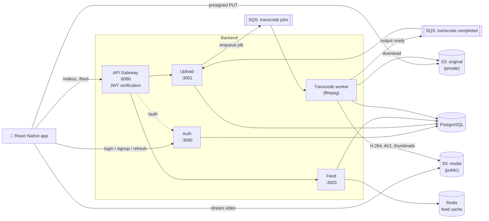

# Short Video

A TikTok-style short-video app built as a set of microservices. Users sign up, upload clips from their phone, and scroll a full-screen vertical feed. Every upload is transcoded in the background into H.264 and AV1.

[](https://www.youtube.com/watch?v=Euiiwb3QKg0)

**▶ [Watch the demo on YouTube](https://www.youtube.com/watch?v=Euiiwb3QKg0)**

---

## Highlights

- **Microservice backend.** Five Node.js services (gateway, auth, upload, transcode, feed). Each has its own responsibility, and they talk over HTTP and message queues.
- **API gateway with a single point of auth.** The gateway checks the JWT once, then passes the caller's identity to the services behind it in trusted headers. Clients can't spoof those headers.
- **Direct-to-S3 uploads.** The upload service hands out presigned URLs, so video files go straight from the phone to object storage and never pass through an API server.
- **Async transcoding pipeline over SQS.** A worker downloads each upload, runs `ffmpeg` to make an **H.264** file (plays on every device) and an **AV1** file (smaller, for hardware decoders), extracts thumbnail frames, and reports each finished file back over a second queue.
- **Retry-safe jobs that resume.** Encodes can be retried safely and pick up where they stopped. If the worker crashes during the AV1 step, the retry re-encodes only AV1. A visibility-timeout heartbeat keeps long encodes from being handed to a second worker.
- **Fast feed.** Pages are fetched by `(created_at, video_id)` cursor rather than offset, and the most-requested first page is cached in **Redis** (cache-aside, 30s TTL, `X-Cache` header). If Redis goes down, the feed still works from Postgres.
- **React Native client.** Full-screen snap-scrolling feed where only the on-screen video plays, landscape support, and silent token refresh.

## Architecture



### How an upload becomes a video in the feed

1. The app calls `POST /videos/upload-init`. The upload service creates a `pending` row and returns a **presigned S3 PUT URL**.
2. The app uploads the file **directly to the private `original` bucket**.
3. The app calls `POST /videos/:id/complete`. The service confirms the object exists (`HeadObject`), queues a transcode job on SQS, and marks the video `uploaded`.
4. The **transcode worker** picks up the job, downloads the original, checks the duration (120s max), extracts thumbnail frames, and encodes **H.264 first, then AV1**. Each output goes to the public `media` bucket.
5. As each output finishes, the worker sends a completion message. The upload service saves the key to `videos.h264_s3_key` / `av1_s3_key`.
6. The video shows up in the **feed** as soon as its H.264 file is ready. It doesn't wait for the slower AV1 encode.

### Auth flow

- **Login** returns a short-lived **access token** (15 min) in the response body and a **refresh token** (7 days) in an `httpOnly` cookie. The refresh token is also stored in Postgres, so it can be revoked.
- Passwords are hashed with **bcrypt**.
- The app's axios interceptor catches `401`/`403` responses, refreshes the access token once (parallel requests share one refresh call), and retries the original request.
- **Logout** deletes the refresh token from the database and clears the cookie.

## Tech stack

| Layer | Technologies |
|---|---|
| Mobile | React Native 0.76, React Navigation, NativeWind (Tailwind), react-native-video, axios |
| Backend | Node.js, Express 5 (ES modules), http-proxy-middleware |
| Auth | JWT (access + refresh tokens), bcrypt, httpOnly cookies |
| Data | PostgreSQL, Redis |
| Storage | S3-compatible object storage (MinIO locally; also works with Cloudflare R2) |
| Messaging | Amazon SQS (ElasticMQ locally), sqs-consumer |
| Video | ffmpeg / ffprobe: libx264 + AAC, SVT-AV1 + Opus |

## Services

| Service | Port | What it does |
|---|---|---|
| [`gateway`](gateway) | 8080 | Public entry point. Verifies JWTs, forwards identity headers plus a shared gateway secret, and proxies to the other services. |
| [`auth`](auth) | 3000 | Signup, login, token refresh, logout. Owns the `users` and `refresh_tokens` tables. |
| [`upload`](upload) | 3001 | Presigned upload URLs, upload completion, queues transcode jobs, and records finished encodes. Owns the `videos` table. |
| [`transcode`](transcode) | — | Headless SQS worker. Downloads, probes, encodes, extracts thumbnails, uploads results. Owns `transcode_jobs`. |
| [`feed`](feed) | 3003 | Read-only paginated feed with a Redis cache for the first page. |
| [`frontend`](frontend) | — | React Native iOS/Android app. |
| [`redis`](redis) | 6379 | Redis config and design notes for the feed cache. |

Each service folder has its own `CLAUDE.md` with deeper architecture notes. [`auth/AUTH_FLOW.md`](auth/AUTH_FLOW.md) and [`redis/README.md`](redis/README.md) walk through the auth and caching designs step by step.

## Design decisions

- **Only the gateway checks JWTs.** Downstream services trust `x-user-id` only when it arrives with the correct `x-gateway-secret`. The gateway overwrites (never appends) those headers, so a client can't inject its own.
- **No body parsing at the gateway.** Request bodies are streamed straight through to the target service, which keeps the gateway a pure proxy.
- **The transcode worker has no HTTP API.** An earlier HTTP trigger let any logged-in user point the worker at an arbitrary URL. It was removed, and the queue is now the only way to submit a job.
- **The worker downloads with its own credentials** instead of taking a presigned URL, so retried and dead-letter-queue messages never fail because a link expired.
- **The job is queued before the status update.** If SQS is down, the video stays `pending` and the client can simply retry `/complete`. Duplicate messages are harmless because the worker skips outputs that are already done.
- **Feed cursors keep Postgres's microsecond timestamps.** A JavaScript `Date` rounds to milliseconds, which would skip or repeat rows at page boundaries.
- **Two codecs.** H.264 is what the feed plays because every device can decode it. AV1 is produced alongside it as a smaller file for devices with hardware AV1 decoders.

## Running locally

### Prerequisites

- Node.js 18+
- PostgreSQL
- [MinIO](https://min.io) (or another S3-compatible store) with a private `original` bucket and a public-read `media` bucket
- [ElasticMQ](https://github.com/softwaremill/elasticmq) (or real SQS) with queues `av1-transcode` and `av1-transcode-completed`
- Redis (optional, the feed works without it)
- `ffmpeg` with `libx264` and `libsvtav1`
- Xcode (iOS) or Android Studio (Android) for the app

### Start the infrastructure

```bash
# SQS-compatible queue
docker run -d --name elasticmq -p 9324:9324 -p 9325:9325 softwaremill/elasticmq

# Redis feed cache
docker run -d --name redis -p 6379:6379 \
  -v "$(pwd)/redis/redis.conf:/usr/local/etc/redis/redis.conf" \
  redis:8-alpine redis-server /usr/local/etc/redis/redis.conf
```

### Configure

Each service reads a `.env` file in its own folder (not committed). The main variables:

| Variable | Used by |
|---|---|
| `DB_USER`, `DB_HOST`, `DB_DATABASE`, `DB_PORT`, `PORT` | all backend services |
| `ACCESS_TOKEN_SECRET`, `REFRESH_TOKEN_SECRET` | auth, gateway (access secret must match) |
| `GATEWAY_SECRET` | gateway, upload, feed (must match) |
| `S3_ENDPOINT`, `AWS_REGION`, `AWS_ACCESS_KEY_ID`, `AWS_SECRET_ACCESS_KEY`, `S3_BUCKET_NAME` | upload, transcode |
| `TRANSCODE_QUEUE_URL`, `TRANSCODE_COMPLETED_QUEUE_URL`, `SQS_ENDPOINT` | upload, transcode |
| `REDIS_URL` | feed |
| `AUTH_API_URL_*`, `VIDEO_API_URL_*`, `MEDIA_URL_*` | frontend (`frontend/.env`) |

Database tables are created on startup, so there's no separate migration step.

### Run

```bash
npm install            # root (installs concurrently)
# then npm install inside each service folder

npm run dev1           # starts gateway, auth, upload, transcode, feed and the iOS app with color-coded logs
```

Or run a single service, e.g. `npm run dev:feed`.

## Project structure

```
.
├── gateway/     # API gateway (reverse proxy + JWT verification)
├── auth/        # users, login, refresh tokens
├── upload/      # presigned uploads, transcode job producer/consumer
├── transcode/   # SQS worker running ffmpeg
├── feed/        # paginated feed + Redis cache
├── redis/       # Redis config and docs
└── frontend/    # React Native app
```

Every backend service uses the same layout: `server.js` → `src/routes` → `src/controller` → `src/models` → `src/config`.

## What's next

- Clear the cached first feed page when a new H.264 file lands, so new videos appear right away instead of within 30s
- Show transcode status (processing / failed) in the app
- Likes, comments, usernames and avatars on posts
- Rate limiting at the gateway (Redis `INCR` + `EXPIRE`)
- Pick AV1 on devices that have a hardware AV1 decoder
- Docker Compose for one-command setup, plus automated tests and CI
